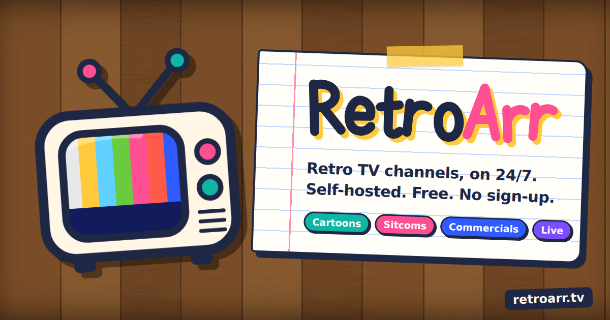

# SurfArr

**Retro cable TV, self-hosted.** SurfArr turns YouTube playlists and Internet Archive shows into always-on TV channels by decade and genre. Tune in any time and it's already playing, the same for everyone, just like broadcast TV.



- **Plex, Jellyfin and Emby** find it as an HDHomeRun tuner, with a full XMLTV guide
- **Any IPTV player** works with the M3U playlist (VLC, TiviMate, IPTV Smarters)
- **40+ channels**: 70s to 20s cartoons, sitcoms, drama and kids, plus Nick at Nite, Fox Kids, Kids WB, MST3K, G4, 24/7 live streams and more
- **Web dashboard** with a TV guide, a CRT-style TV mode, and add-on channel packs
- **One Docker container**, with FFmpeg and yt-dlp built in

Just want to watch? Try it in your browser at [surfarr.tv](https://surfarr.tv).

## Quick start

```yaml
# docker-compose.yml
services:
  surfarr:
    image: f00d4tehg0dz/surfarr:latest
    container_name: surfarr
    restart: unless-stopped
    network_mode: host            # lets Plex/Jellyfin find the tuner on their own
    volumes:
      - retroarr-db:/app/server/db
    environment:
      - TZ=America/New_York
      - REMOTE_API_URL=https://retroarr-api.f00d.me

volumes:
  retroarr-db:
```

```bash
docker compose up -d
```

Open `http://<your-ip>:8888`, give the first sync a minute, then add the tuner in your media server:

| | |
|---|---|
| Tuner (HDHomeRun) | `http://<your-ip>:8888` |
| Guide (XMLTV) | `http://<your-ip>:8888/epg.xml` |
| Playlist (M3U) | `http://<your-ip>:8888/lineup.m3u` |

On Windows or macOS (Docker Desktop), use `ports: ["8888:8888"]` instead of host networking and add the tuner by URL.

## Docs

The [wiki](https://github.com/f00d4tehg0dz/surfarr/wiki) covers everything else:

- [Installation](https://github.com/f00d4tehg0dz/surfarr/wiki/Installation): Docker, NAS, manual install, and upgrading from RetroArr
- [Connecting your media server](https://github.com/f00d4tehg0dz/surfarr/wiki/Connecting-Media-Servers)
- [Configuration](https://github.com/f00d4tehg0dz/surfarr/wiki/Configuration): every environment variable
- [Channels](https://github.com/f00d4tehg0dz/surfarr/wiki/Channels), [Dashboard](https://github.com/f00d4tehg0dz/surfarr/wiki/Dashboard), [Plugins](https://github.com/f00d4tehg0dz/surfarr/wiki/Plugins), [Commercials](https://github.com/f00d4tehg0dz/surfarr/wiki/Commercials)
- [Troubleshooting](https://github.com/f00d4tehg0dz/surfarr/wiki/Troubleshooting)

Coming from RetroArr? Change the image to `f00d4tehg0dz/surfarr:latest` and keep the `retroarr-db` volume. Your channels and tuner carry over.

## Contributing

Pull requests are welcome: bug fixes, UI work, and especially new channel packs (see [Plugins](https://github.com/f00d4tehg0dz/surfarr/wiki/Plugins)). For development, run `npm run dev` in both `server/` and `client/`.

## License

[GPL-3.0](LICENSE)
